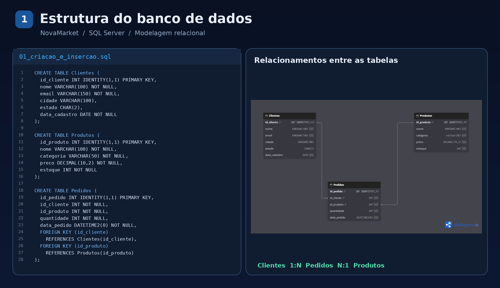
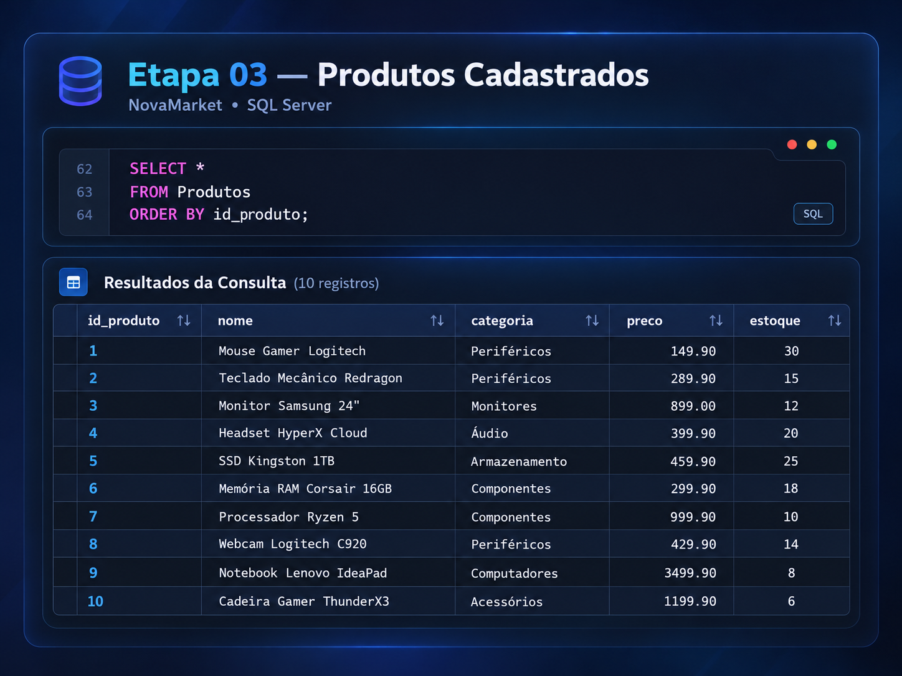
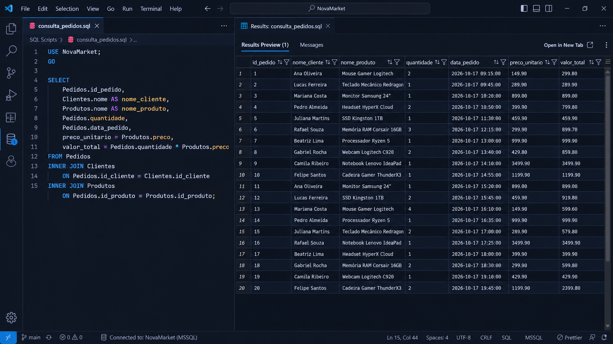
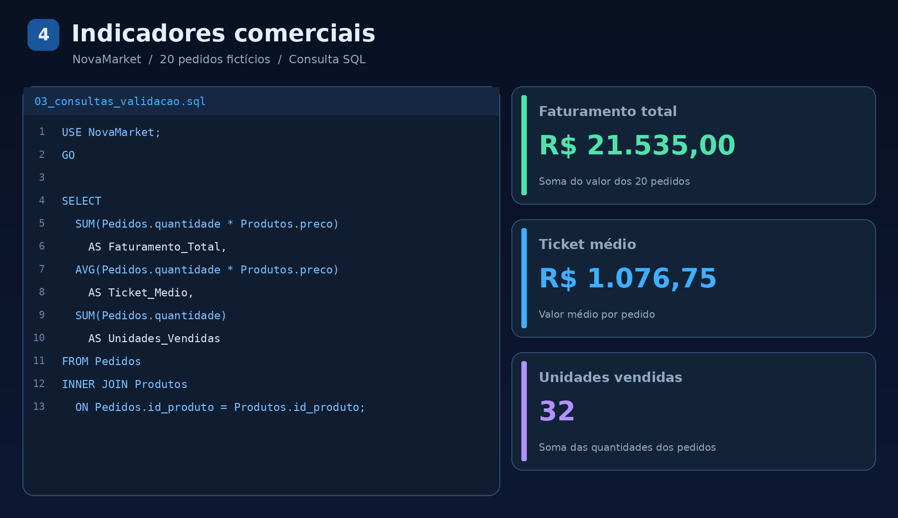
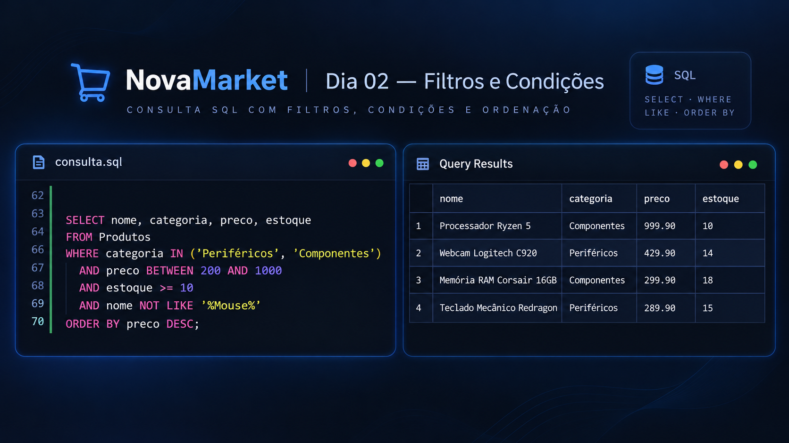

# NovaMarket — Fundamentos de SQL Server

Projeto de aprendizado e portfólio: criação de um banco de dados relacional fictício para uma loja de eletrônicos, cadastro de informações e consultas de análise comercial.

## Tecnologias

- Microsoft SQL Server (T-SQL)
- Visual Studio Code com extensão SQL Server (mssql)
- Git/GitHub para versionamento
- dbdiagram.io para visualização da estrutura

## Estrutura relacional

Três tabelas: `Clientes`, `Produtos` e `Pedidos`. As chaves primárias utilizam `IDENTITY(1,1)`; `Pedidos` referencia as outras duas tabelas por chaves estrangeiras.



> **Limitação didática:** cada linha da tabela `Pedidos` representa a compra de um único produto. Uma evolução futura será separar `Pedidos` e `ItensPedido` para suportar vários produtos por pedido e armazenar o preço praticado na venda.

## Como reproduzir

**Requisitos:** uma instância SQL Server acessível e uma ferramenta que execute T-SQL com separadores `GO`.

1. Abra `scripts/01_criacao_banco.sql` e execute **em uma instância que ainda não contenha o banco `NovaMarket`**.
2. Execute `scripts/02_insercao_dados.sql` **uma única vez** para cadastrar 10 clientes, 10 produtos e 20 pedidos fictícios.
3. Execute `scripts/03_consultas_validacao.sql` para verificar quantidades, identidades e relacionamentos.
4. Execute `scripts/04_analises_comerciais.sql` para obter pedidos detalhados e indicadores.

**Não execute o script de criação sobre o banco já existente.** Os scripts de instalação não são migrações nem foram feitos para execução repetida. O arquivo `scripts/05_estudos_alteracoes.sql` é um registro didático e não faz parte da sequência principal.

No script de pedidos, os IDs são encontrados por e-mail do cliente e nome do produto, em vez de depender de lacunas específicas no contador `IDENTITY` do banco usado durante os estudos. Isso permite reproduzir os mesmos pedidos em uma instalação nova.

## Dados e resultados

- **10 clientes** fictícios
- **10 produtos** de eletrônicos
- **20 pedidos** fictícios
- **Faturamento calculado:** R$ 21.535,00
- **Ticket médio por pedido:** R$ 1.076,75
- **Unidades vendidas:** 32

Os valores refletem apenas dados de demonstração e consideram o **preço atual** da tabela `Produtos`, sem descontos, impostos ou frete. Não representam faturamento de uma empresa real.

### Consulta de produtos



### Consulta com INNER JOIN



### Indicadores comerciais



## Conceitos praticados

`CREATE DATABASE`, `USE`, `CREATE TABLE`, tipos de dados (`INT`, `VARCHAR`, `CHAR`, `DATE`, `DECIMAL`, `DATETIME2`), `PRIMARY KEY`, `FOREIGN KEY`, `NOT NULL`, `IDENTITY`, `INSERT INTO`, `SELECT`, `ORDER BY`, `INNER JOIN`, aliases, expressões calculadas, `SUM`, `AVG` e `COUNT`. Também foram estudados `ALTER TABLE` e `DROP TABLE` durante o desenvolvimento.

## Organização de arquivos

```text
NovaMarket_SQL_Organizado/
├── README.md
├── scripts/
│   ├── 01_criacao_banco.sql
│   ├── 02_insercao_dados.sql
│   ├── 03_consultas_validacao.sql
│   ├── 04_analises_comerciais.sql
│   └── 05_estudos_alteracoes.sql
├── imagens/
│   ├── 01_estrutura_relacional.png
│   ├── 02_produtos_cadastrados.png
│   ├── 03_inner_join.png
│   └── 04_indicadores_comerciais.png
└── historico_original/  # arquivos do processo de aprendizagem, nao executar
```

O material visual é uma apresentação estilizada das consultas e do diagrama; para conferir os comandos executáveis, consulte os arquivos da pasta `scripts`.

## Dia 02 — Filtros e condições

Nesta etapa, foram exploradas técnicas de filtragem
e ordenação de dados utilizando T-SQL.

**Conceitos aplicados:**
- WHERE, AND e OR
- BETWEEN
- IN e NOT IN
- LIKE e NOT LIKE
- Operadores de comparação
- ORDER BY ASC e DESC

### Aplicação prática

Foi desenvolvida uma consulta para identificar
produtos elegíveis para uma campanha comercial,
considerando simultaneamente categoria, preço,
estoque e exclusões por nome.

**Resultado:** 4 produtos elegíveis.



O código completo está disponível em
[scripts/05_filtros_e_condicoes.sql](scripts/05_filtros_e_condicoes.sql).
